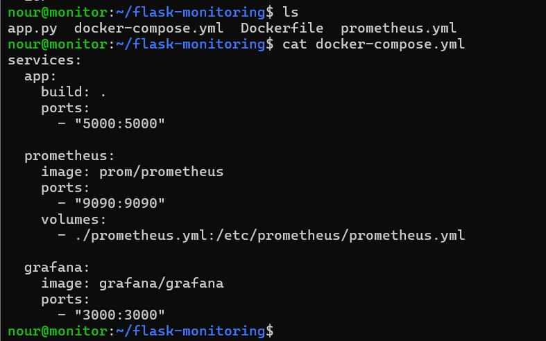
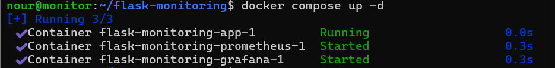
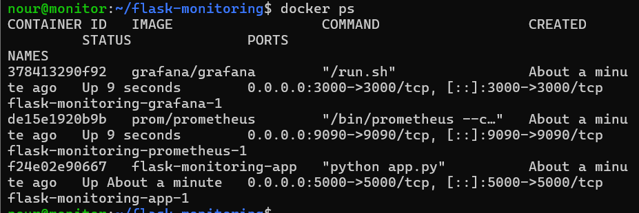
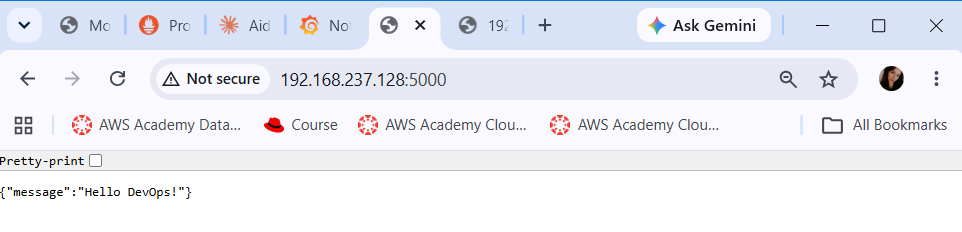
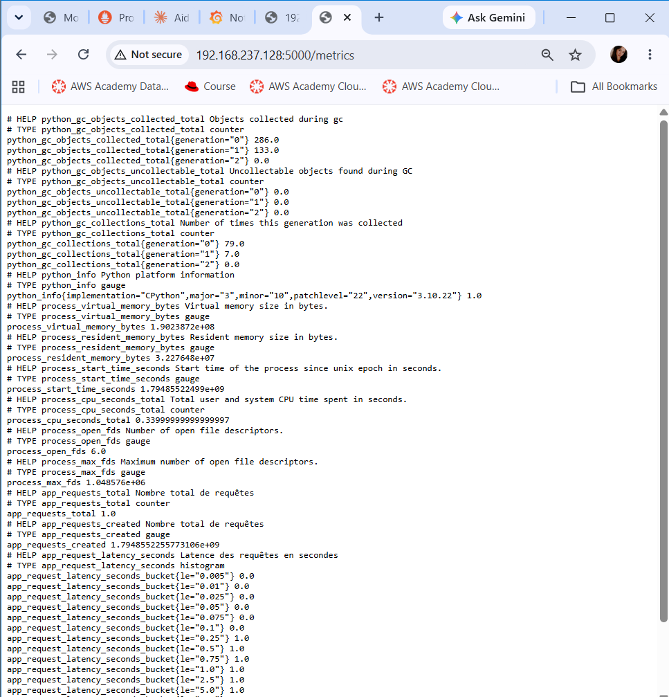
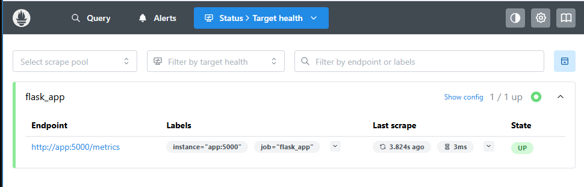
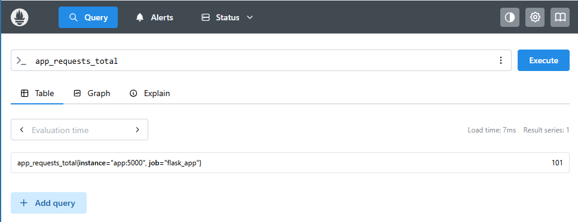
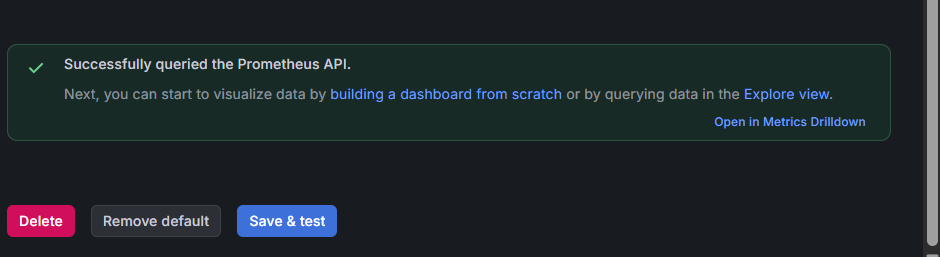
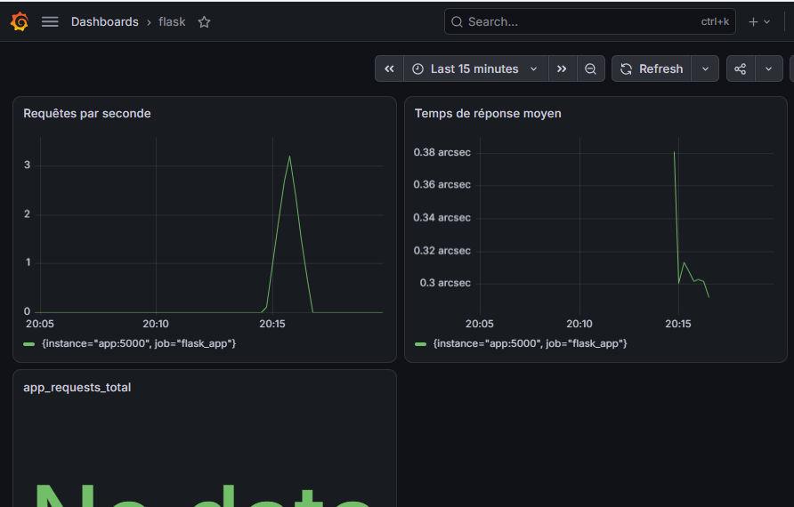

# TP : Monitoring d'une application web avec Prometheus et Grafana

**Établissement :** ISET Tozeur, Master DevOps et Cloud Computing (2e année)
**Matière :** Disponibilité des infrastructures
**Étudiante :** Nour Kidoudi

---

## 1. Objectif

Mettre en place un monitoring complet d'une application web simple développée avec **Flask**, afin d'observer :

- ses métriques internes (nombre de requêtes traitées, temps de réponse) ;
- son état dans **Prometheus** (collecte des métriques) ;
- ses indicateurs dans un tableau de bord **Grafana** (visualisation).

## 2. Architecture

Trois services sont déployés avec **Docker Compose** sur le même réseau :

| Service | Image | Port | Rôle |
|---|---|---|---|
| `app` | construite depuis le `Dockerfile` (Python 3.10) | 5000 | Application Flask qui expose `/` et `/metrics` |
| `prometheus` | `prom/prometheus` | 9090 | Collecte les métriques de l'application toutes les 5 secondes |
| `grafana` | `grafana/grafana` | 3000 | Visualise les métriques dans un dashboard |

Flux de données : **Flask (`/metrics`) → Prometheus (scrape toutes les 5 s) → Grafana (requêtes PromQL)**.

## 3. Structure du projet

```
flask-monitoring/
├── app.py
├── Dockerfile
├── docker-compose.yml
├── prometheus.yml
├── captures/
└── README.md
```

## 4. Mise en place

### 4.1 Création du projet

```bash
mkdir flask-monitoring && cd flask-monitoring
```

### 4.2 Application Flask (`app.py`)

L'application expose deux routes :

- `/` : simule un traitement aléatoire (0,1 à 0,5 s), incrémente le compteur et enregistre la latence ;
- `/metrics` : expose les métriques au format Prometheus.

Deux métriques sont définies :

- `app_requests_total` (**Counter**) : nombre total de requêtes ;
- `app_request_latency_seconds` (**Histogram**) : latence des requêtes en secondes.

```python
from flask import Flask, jsonify
from prometheus_client import Counter, Histogram, generate_latest, CONTENT_TYPE_LATEST
import time
import random

app = Flask(__name__)

# Définition des métriques
REQUEST_COUNT = Counter('app_requests_total', 'Nombre total de requêtes')
REQUEST_LATENCY = Histogram('app_request_latency_seconds', 'Latence des requêtes en secondes')

@app.route('/')
def index():
    start_time = time.time()
    REQUEST_COUNT.inc()
    # Simulation d'un traitement aléatoire
    time.sleep(random.uniform(0.1, 0.5))
    REQUEST_LATENCY.observe(time.time() - start_time)
    return jsonify(message="Hello DevOps!"), 200

@app.route('/metrics')
def metrics():
    return generate_latest(), 200, {'Content-Type': CONTENT_TYPE_LATEST}

if __name__ == '__main__':
    app.run(host='0.0.0.0', port=5000)
```

### 4.3 Dockerfile

```dockerfile
FROM python:3.10-slim
WORKDIR /app
COPY app.py .
RUN pip install flask prometheus_client
EXPOSE 5000
CMD ["python", "app.py"]
```

### 4.4 Docker Compose (`docker-compose.yml`)

```yaml
services:
  app:
    build: .
    ports:
      - "5000:5000"

  prometheus:
    image: prom/prometheus
    ports:
      - "9090:9090"
    volumes:
      - ./prometheus.yml:/etc/prometheus/prometheus.yml

  grafana:
    image: grafana/grafana
    ports:
      - "3000:3000"
```

> La ligne `version: '3'` a été retirée : elle est obsolète dans les versions récentes de Docker Compose.

### 4.5 Configuration de Prometheus (`prometheus.yml`)

```yaml
global:
  scrape_interval: 5s

scrape_configs:
  - job_name: 'flask_app'
    static_configs:
      - targets: ['app:5000']
```

Prometheus interroge l'endpoint `/metrics` du service `app` toutes les 5 secondes. Le nom `app` est résolu par le réseau interne de Docker Compose.

**Capture : fichiers du projet**



## 5. Lancement de la stack

```bash
docker compose up -d --build
docker ps
```

Les trois conteneurs (`app`, `prometheus`, `grafana`) doivent être à l'état **Up**.

**Capture : démarrage avec Docker Compose**



**Capture : conteneurs en cours d'exécution**



## 6. Test des services

### 6.1 Application Flask

L'application répond sur `http://localhost:5000` avec le message `{"message":"Hello DevOps!"}`.



### 6.2 Endpoint des métriques

L'endpoint `http://localhost:5000/metrics` expose `app_requests_total` et les séries de l'histogramme `app_request_latency_seconds`.



### 6.3 Prometheus : état de la cible

Dans **Status → Target health**, la cible `flask_app` apparaît à l'état **UP**, ce qui confirme que Prometheus collecte bien les métriques de l'application.



### 6.4 Prometheus : requête PromQL

La requête `app_requests_total` dans l'onglet **Query** retourne le nombre total de requêtes reçues par l'application.



## 7. Dashboard Grafana

### 7.1 Source de données

Dans **Connections → Data sources**, une source **Prometheus** a été ajoutée avec l'URL `http://prometheus:9090`.

On utilise le nom du service `prometheus` et non `localhost`, car Grafana s'exécute dans un conteneur : `localhost` désignerait alors le conteneur Grafana lui-même.



### 7.2 Panneaux du dashboard

Un dashboard **Flask Monitoring** a été créé avec trois panneaux :

| Panneau | Requête PromQL | Type |
|---|---|---|
| Requêtes par seconde | `rate(app_requests_total[1m])` | Time series |
| Temps de réponse moyen | `rate(app_request_latency_seconds_sum[1m]) / rate(app_request_latency_seconds_count[1m])` | Time series (unité : secondes) |
| Total des requêtes | `app_requests_total` | Stat |

**Explication des requêtes :**

- `rate(app_requests_total[1m])` calcule le nombre moyen de requêtes par seconde sur la dernière minute.
- Le temps de réponse moyen correspond à la somme des durées (`_sum`) divisée par le nombre d'observations (`_count`), toutes deux exprimées en taux sur 1 minute.
- `app_requests_total` donne la valeur cumulée du compteur depuis le démarrage de l'application.


## 8. Test du monitoring

Du trafic est généré vers l'application pendant que le dashboard est ouvert (actualisation automatique toutes les 5 secondes) :

```bash
for i in $(seq 1 200); do curl -s http://localhost:5000/ > /dev/null; done
```

On observe que :

- le **total des requêtes** augmente ;
- la courbe des **requêtes par seconde** monte pendant l'envoi du trafic, puis retombe à zéro ;
- le **temps de réponse moyen** reste d'environ 0,3 s, ce qui est cohérent avec le délai aléatoire de 0,1 à 0,5 s simulé dans le code.



## 9. Problèmes rencontrés et solutions

| Problème | Cause | Solution |
|---|---|---|
| `Bind for 0.0.0.0:3000 failed: port is already allocated` | Le port 3000 était déjà utilisé par un conteneur Grafana d'un TP précédent | Arrêt de l'ancien conteneur avec `docker compose down` (ou changement du mapping de port dans `docker-compose.yml`) |
| `Page not found` sur `http://localhost:9090/graph` | La nouvelle interface de Prometheus n'utilise plus l'adresse `/graph` | Utilisation de `http://localhost:9090/query` |
| Panneaux Grafana vides (« No data ») | Aucune requête récente, donc `rate()` ne renvoie rien | Génération de trafic avec `curl` avant d'afficher les graphiques |

## 10. Commandes utiles

```bash
# Voir l'état des conteneurs
docker ps

# Consulter les logs d'un service
docker compose logs app
docker compose logs prometheus

# Arrêter la stack
docker compose down
```

## 11. Conclusion

Ce TP a permis de mettre en place une chaîne de monitoring complète : instrumentation d'une application Flask avec `prometheus_client`, collecte des métriques par Prometheus, puis visualisation dans Grafana avec des requêtes PromQL. Les indicateurs suivis (requêtes par seconde, latence moyenne, total des requêtes) réagissent bien au trafic envoyé, ce qui valide le fonctionnement de l'ensemble.
